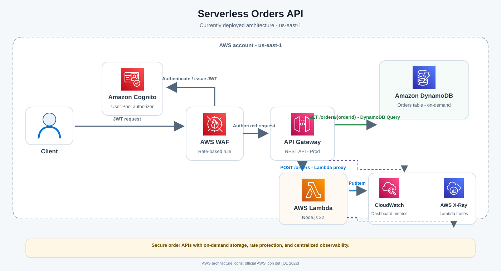

# Serverless Orders API

## Project objective

Build and evolve a serverless order service on AWS. The application stores order items in DynamoDB, exposes create and read operations through an API Gateway REST API, and adds authentication, request protection, monitoring, and automated delivery.

## Architecture

### Deployed AWS architecture (`us-east-1`)



The diagram uses official [AWS Architecture Icons](https://aws.amazon.com/architecture/icons/) (Q1 2022 package). The SVG embeds the icon artwork so GitHub can display it without external image requests.

Request flow:

1. Clients authenticate with Amazon Cognito and attach the resulting JWT to API requests.
2. AWS WAF applies the rate-based rule before requests reach API Gateway.
3. `POST /orders` invokes the Node.js Lambda function, which validates the order item and writes it to DynamoDB.
4. `GET /orders/{orderId}` queries DynamoDB directly through API Gateway.
5. CloudWatch displays API and Lambda metrics; active X-Ray tracing is enabled for Lambda.

## Delivered capabilities

- **On-demand order storage:** The `Orders` DynamoDB table uses `orderId` as its partition key and `itemId` as its sort key, with pay-per-request billing.
- **Create orders:** `POST /orders` invokes a Node.js 22 Lambda that validates input and writes order items with DynamoDB `PutItem`.
- **Retrieve orders:** `GET /orders/{orderId}` retrieves an order's items using API Gateway's direct DynamoDB `Query` integration.
- **Authentication:** Both API methods use a Cognito User Pool authorizer. User creation is configured for administrators.
- **Request protection:** An AWS WAF rate-based rule is associated with the API stage and configured for 1,000 requests per IP over the five-minute evaluation window.
- **Observability:** The `OrdersApiDashboard` CloudWatch dashboard displays API Gateway `Count`/`4XXError` and Lambda `Invocations`/`Errors`. Lambda active tracing is enabled with X-Ray.
- **Automated delivery:** GitHub Actions builds and deploys the SAM application on pushes to `main` and on manual dispatch, using GitHub OIDC.

The deployed CloudFormation stack is `orders-table-stack` in `us-east-1`.

## How the project was developed

1. **Created the data model.** Defined a DynamoDB table with a composite key so each order can contain multiple order items. On-demand capacity avoids provisioning throughput in advance.
2. **Added order creation.** Implemented a Lambda handler for input validation and `PutItem`, with table-scoped IAM permissions.
3. **Exposed REST operations.** Added a Lambda-backed `POST /orders` route and a direct API Gateway-to-DynamoDB `GET /orders/{orderId}` query.
4. **Secured the API.** Applied a Cognito User Pool authorizer and attached a regional WAF rate-based rule.
5. **Added operational visibility.** Created CloudWatch metric widgets and enabled X-Ray active tracing for Lambda.
6. **Automated delivery.** Added a GitHub Actions workflow with Node.js 22, SAM build, locked npm dependencies, and OIDC role assumption.

## API usage

Base URL:

```text
https://wgybxq9dkf.execute-api.us-east-1.amazonaws.com/Prod
```

| Method and path | Purpose |
|---|---|
| `POST /orders` | Save an order item through Lambda |
| `GET /orders/{orderId}` | Retrieve items for an order through DynamoDB `Query` |

Both routes require a valid Cognito User Pool token:

```http
Authorization: Bearer <cognito-id-token>
```

The POST body must be JSON with non-empty string values for `orderId` and `itemId`. Other JSON properties are saved with the item. Lambda returns `201` after saving and `400` for invalid JSON or missing/invalid keys.

The User Pool is admin-managed. A Cognito hosted UI domain or user-facing login page is not configured.

## Future improvements

- **Faster repeated reads:** DAX can cache DynamoDB reads. API Gateway stage caching can reuse GET responses; the proposed setting uses `orderId` as the cache key and a 300-second TTL.
- **Multi-Region recovery:** DynamoDB Global Tables can replicate data to another Region, such as `eu-west-1`.
- **Change data capture:** DynamoDB Streams can publish table changes for downstream processing.

These are extension paths, not part of the deployed architecture. Consider account eligibility, operational needs, and AWS pricing before adopting them.

## Challenges and lessons learned

- **DAX account access:** The AWS account rejected DAX provisioning because it reported that the account needs a subscription for the service. CloudFormation rolled back the attempted update. The currently deployed API remains available using the direct DynamoDB GET integration. The source/template contains a proposed DAX-backed Lambda design, but it is not deployed.
- **CloudFormation resource migration:** CloudFormation rejected changing the existing `Orders` resource from `AWS::DynamoDB::Table` to `AWS::DynamoDB::GlobalTable` with “Update of resource type is not permitted.” The deployed table remains regional. A safe Global Tables migration requires a separately named table, a data copy and verification, application cutover, and later retirement of the original.
- **Template versus deployed state:** The template describes API Gateway caching and DynamoDB Streams, but these updates did not reach the live stack. The live API cache is disabled and the live table has no stream or replica.
- **Cost and dependency review:** DAX and API Gateway cache clusters can incur ongoing charges. The proposed single `dax.t3.small` node has no node-level high availability. The Node.js DAX client depends on AWS SDK for JavaScript v2, which is end-of-support; npm audit reported moderate advisories in the dependency chain.
- **CI/CD deployment:** A push to `main` starts the deployment workflow. Because the current template includes DAX, the workflow may fail at DAX provisioning until account access is resolved or the DAX resources are removed.

## Build and deploy

Prerequisites: Node.js 22, npm, AWS SAM CLI, and AWS credentials authorized to deploy the stack.

From PowerShell:

```powershell
cd "C:\path\to\SERVERLESS_APP"
$env:Path = "C:\Program Files\nodejs;$env:Path"

Push-Location .\src
npm ci
if ($LASTEXITCODE -ne 0) {
    Pop-Location
    throw "npm ci failed"
}
Pop-Location

$env:Path = "$PWD\src\node_modules\.bin;$env:Path"
sam validate --template-file template.yaml --lint
sam build
```

`sam build` is local and does not change AWS resources. To deploy the existing stack:

```powershell
sam deploy --stack-name orders-table-stack --region us-east-1 --resolve-s3 --capabilities CAPABILITY_IAM
```

Review the CloudFormation change set before approving it, especially when changing stateful resources.

## Automated deployment

`.github/workflows/deploy.yml` runs on pushes to `main` and on manual dispatch. It checks out the repository, installs Node.js 22 and SAM CLI, installs locked dependencies with `npm ci`, assumes `arn:aws:iam::525391386782:role/GitHubActions-OrdersAPI-Deploy` via GitHub OIDC, then builds and deploys `orders-table-stack` in `us-east-1`. The AWS role trust policy must allow this repository's GitHub Actions workflow to assume it.

## Repository layout

```text
.
├── .github/
│   └── workflows/
│       └── deploy.yml       # CI/CD build and deployment
├── docs/
│   ├── assets/aws/          # AWS service icon source SVGs
│   └── orders-architecture.svg
├── src/
│   ├── index.js             # Lambda handler
│   ├── package.json         # Runtime and build dependencies
│   └── package-lock.json    # Locked npm dependency graph
├── template.yaml            # SAM and CloudFormation resources
└── README.md                # Project objective, architecture, and development story
```
